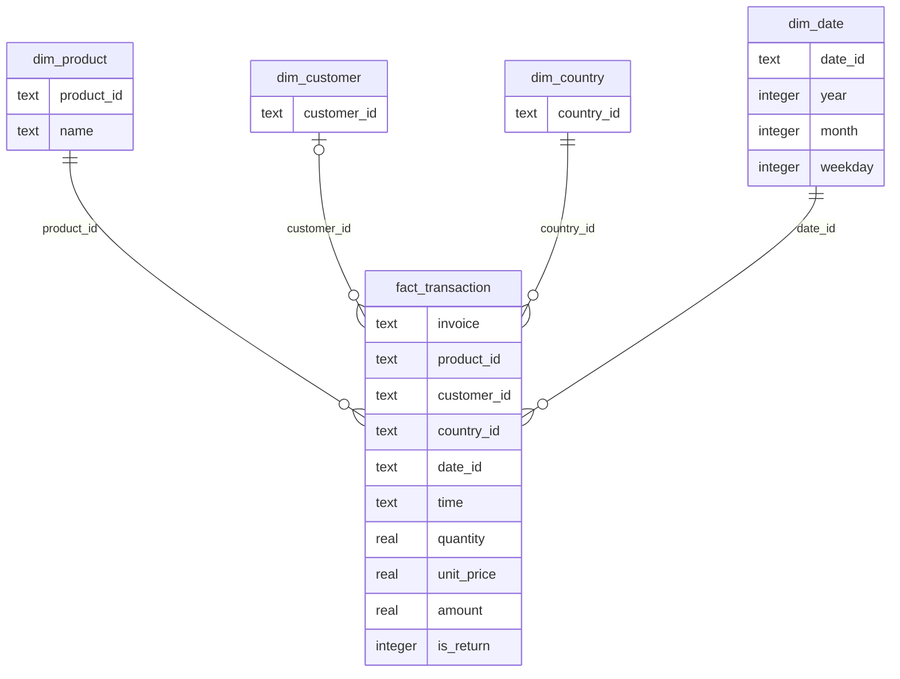

# Retail Observatory: analysis and demonstration notes

## Source and lineage

The user selected [Online Retail II on Kaggle](https://www.kaggle.com/datasets/mashlyn/online-retail-ii-uci). This project downloads the original [UCI Online Retail II workbook](https://archive.ics.uci.edu/dataset/502/online+retail+ii), Daqing Chen, DOI [10.24432/C5CG6D](https://doi.org/10.24432/C5CG6D), CC BY 4.0. It contains 1,067,371 line items across two sheets, from 1 December 2009 to 9 December 2011. These are invoice lines, not 1,067,371 distinct orders. All prices are pounds sterling.

`data/raw/` preserves the source archive and workbook. `data/metadata.json` records the workbook SHA-256, sheet names, extraction time and quality audit. `scripts/prepare_data.py` builds `data/retail.sqlite`. The raw folder is a small immutable landing zone, not a claim that this local project implements an enterprise data lake.

## Warehouse model

The SQLite analytical warehouse has one fact table at invoice-line grain and four conformed dimensions. No customer name, gender, acquisition channel, inventory, item cost, margin, traffic or payment data exists in the source.

Dimensions use unique natural-key indexes. The ETL validates membership by constructing all dimensions from the retained facts; SQLite foreign-key constraints are not declared. Customers may be null.

## KDD and preprocessing

1. Select the two source sheets and integrate identical schemas.
2. Audit raw duplicates, missing values, invalid prices, cancellations and negative quantities. Raw issue counts can overlap.
3. Drop exact duplicate rows (34,335). Identical legitimate repeat lines could be removed by this policy; the decision is transparent and reproducible.
4. Keep merchandise codes matching five digits with up to two trailing letters. This excludes postage, bank charges, vouchers and manual service codes (5,980 additional lines). It is a code-format heuristic, not an externally verified product taxonomy.
5. Require positive prices, nonzero quantity and valid date/country (5,928 additional lines). Do not impute prices or customer identity.
6. Treat C-prefixed invoices as negative credits; retain other negative quantities at positive prices as credit/return activity. A recorded credit does not prove a completed cash refund.
7. Retain missing customer IDs for sales analysis. Exclude these lines only from customer methods. Do not remove wholesale-sized purchases merely as outliers.
8. Assign each product its most frequent recorded description, breaking ties alphabetically. Historical names can differ from this canonical label.

The resulting merchandise fact table has 1,021,128 rows. Sequential exclusions are disjoint and reconcile exactly to the source row count.

## Metric definitions

- Gross sales: sum of positive-quantity merchandise line values.
- Credits/returns: absolute sum of negative line values, including cancellations. A credit can relate to a sale outside the filter period.
- Net revenue: gross sales minus credits/returns. No tax, shipping, cost or profit is inferred.
- Orders: distinct invoice IDs with positive merchandise sales. Cancellation invoice IDs do not count as sale orders.
- Units sold: positive quantities only; returned units are not subtracted from this label.
- AOV: gross sales divided by sale orders, not net revenue divided by orders.
- Customers: unique known customer IDs with positive sales in scope.
- Repeat rate: share of known customers with at least two distinct sale invoices in scope. It is not a lifetime retention rate.
- Return value rate: credit value divided by gross sale value. This may exceed 100% in a small slice, because original sales may be outside it.
- Country share: share of gross merchandise sales. All amounts remain GBP; countries do not imply local currencies.
- Period comparison: preceding equal-length calendar-day range. A comparison is available only when the entire preceding range lies within source coverage. Partial December 2011 must not be presented as a full month.

## Customer methods

RFM measures recency from the day after the selected end date, frequency as distinct positive invoices and monetary value as gross positive spend. Each variable gets percentile-rank scores 1–5; recency is reversed. Ties receive the same score. Segment rules, evaluated in order: R≥4 and F≥4 → Champions; F≥4 → Loyal customers; R≥4 and F≤2 → New customers; R≥3 and F≥2 → Potential loyalists; R≤2 and F≥3 → At risk; all others → Hibernating. These are descriptive heuristic names, not observed lifecycle labels or predictions. Monetary score is available but the named rules use R/F.

K-means is a separate learned grouping on standardized log1p R/F/M, with k=4 (reduced for small selections), random_state=42, n_init=10. The logarithm reduces wholesale-scale skew; standardization balances features. Cluster numbers are ordered by average monetary value. The silhouette coefficient (−1 to 1) is measured on up to 1,500 seeded sampled customers; higher values indicate greater geometric separation. This does not prove commercially correct segmentation. K=4 is a demonstration choice, not an optimized cluster count.

Cohorts use the first **observed purchase inside the selected scope** and calendar-month follow-up. The source does not establish lifetime acquisition. An unobserved future month is null, while an observed month with no returning shoppers is 0%. Only the latest 12 cohorts and first 12 age months are displayed. A partial month has incomplete follow-up.

## Frequent patterns and association rules

Two-item Apriori candidate generation is bounded to the 80 products most frequently present in sale invoices. Repeated units of one product count once per basket. The denominator is all positive merchandise invoices in the selected scope, including baskets with no top-80 product.

For A → B: support = baskets containing both / all baskets; confidence = baskets containing both / baskets containing A; lift = confidence / support(B). Support and confidence display as percentages. Minimum pair count is max(20, ceil(0.2% × basket count)), confidence at least 15%, lift above 1. The dashboard shows the 20 directional rules with greatest lift. Rules are exploratory associations; high lift can occur for niche pairs and is not evidence of causality. The count threshold and bounded product pool are explicit limitations. This is exact frequent-pair mining, not unrestricted higher-order Apriori or FP-growth.

## Syllabus connections and choices

This implementation demonstrates data warehousing via a dimensional schema; KDD through selection, cleaning, integration, transformation and interpretation; EDA through time-series, heatmaps, histograms, rankings and concentration curves; partition-based clustering through K-means and silhouette evaluation; and frequent-itemset association metrics through Apriori pairs.

Decision trees, Naïve Bayes and regression are not forced into the dataset. A credible predictive model would require an explicit target, historical feature windows and temporal validation to avoid leakage. Hierarchical clustering is another valid extension but is not necessary to explain the present business questions.

## Suggested demonstration path

Open Overview to establish dataset coverage and metrics. Filter 2011 or a country and show every view updating. Use Sales for seasonality and the purchase-hour pattern. Move to Customers to distinguish heuristic RFM from learned K-means, then explain cohort censoring. Use Products for the Pareto curve and an association rule's support/confidence/lift. Finish in Data lab with the row reconciliation, limitations, source and CSV export.
